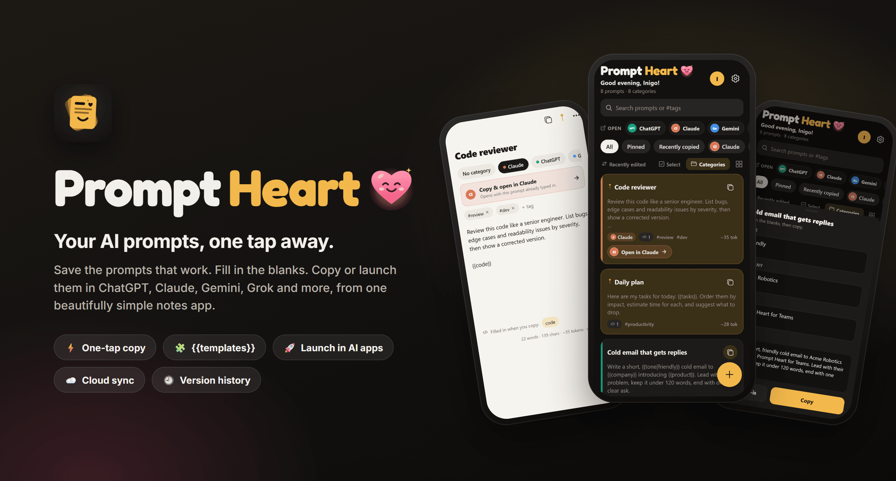
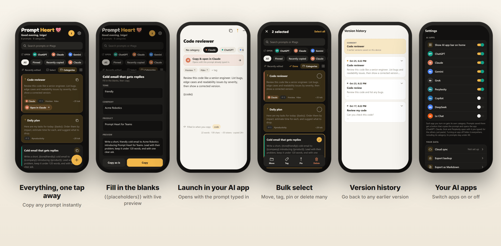
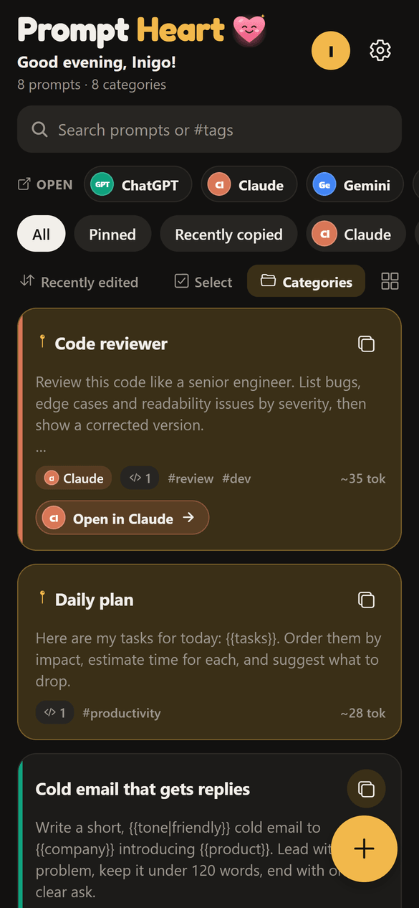
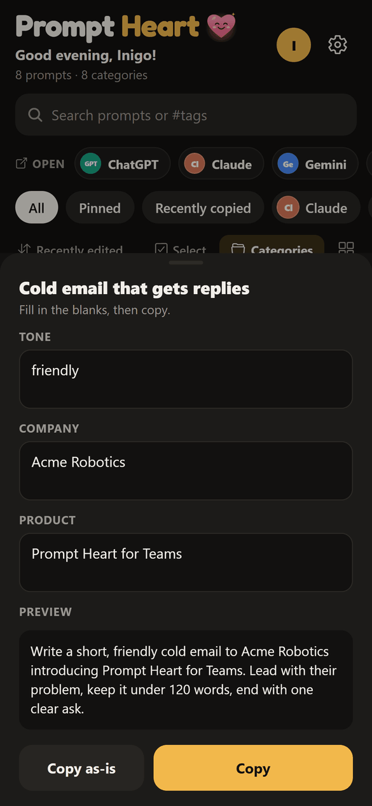
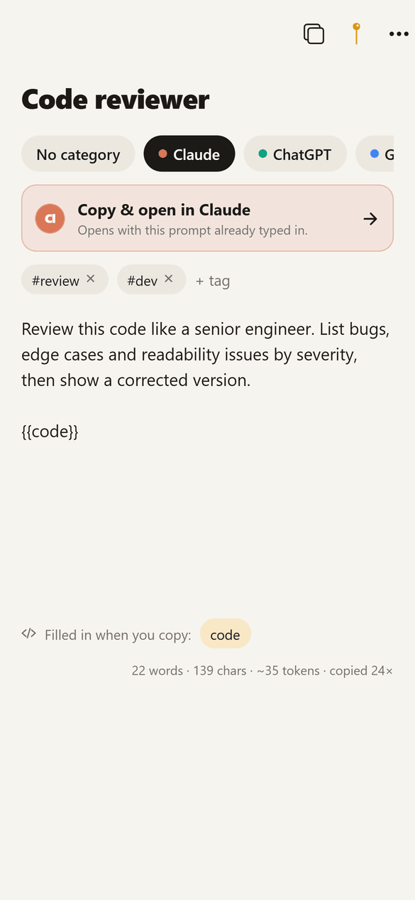
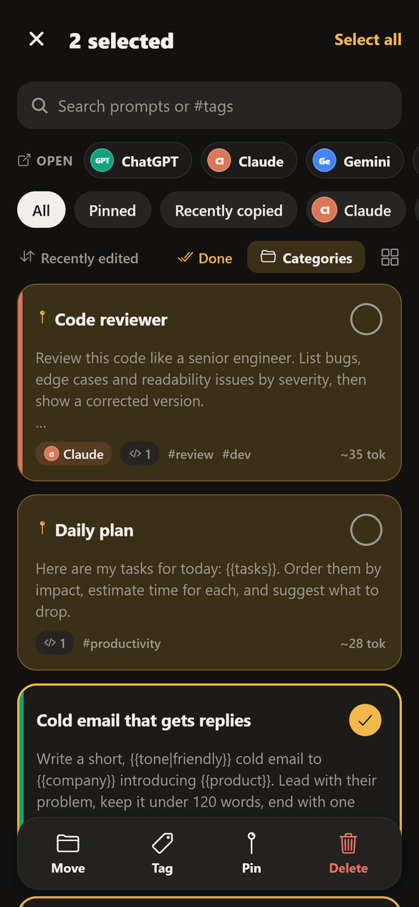
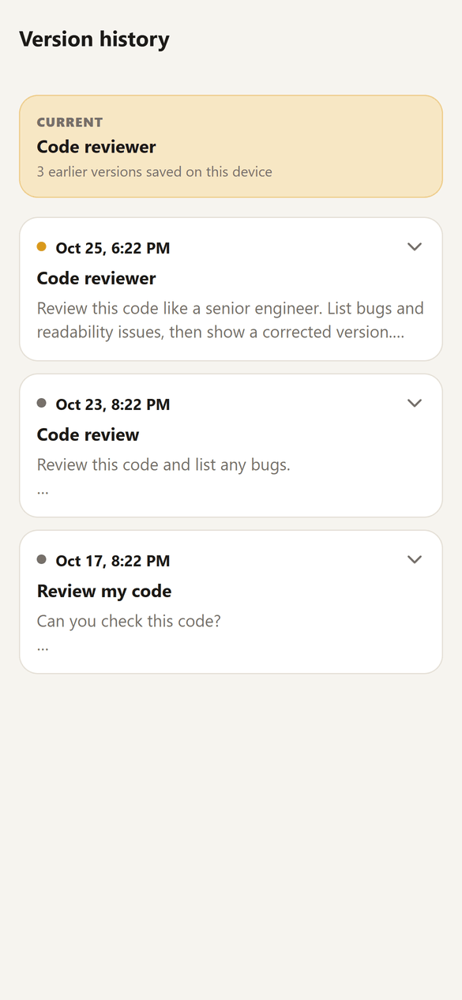
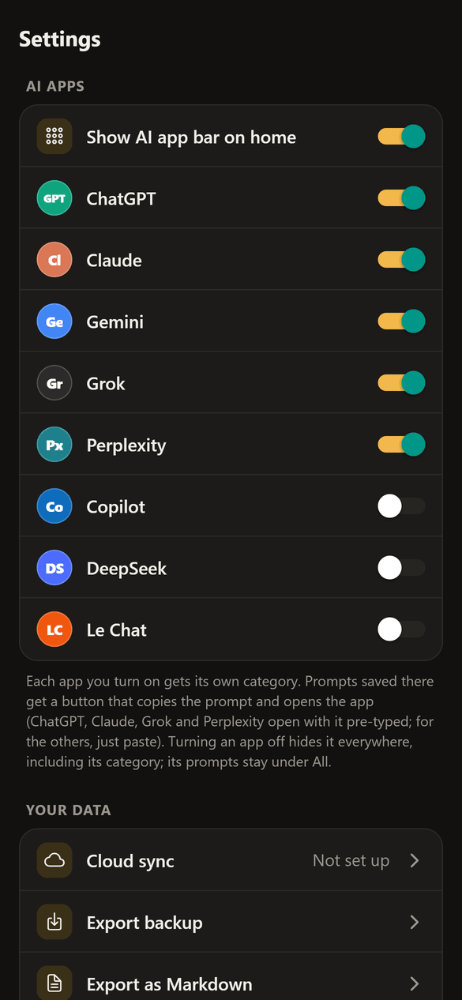
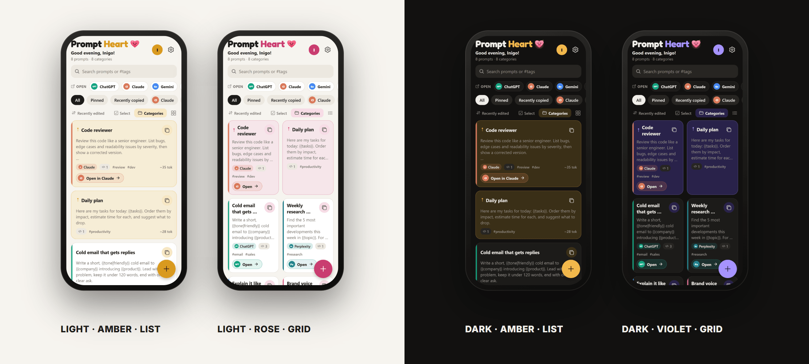

<p align="center">
  
</p>

<p align="center">
  <a href="../../releases/latest"></a>
  
  
  
  
</p>

<h3 align="center">Stop losing your best prompts.</h3>

<p align="center">
<b>Prompt Heart</b> is a notes-style home for the prompts that actually work.<br/>
Save them in seconds, fill in the blanks when you need them, and copy or launch them in<br/>
<b>ChatGPT, Claude, Gemini, Grok, Perplexity</b> and more, with a single tap.
</p>

<br/>

## ✨ Highlights

<table>
  <tr>
    <td width="33%" valign="top">
      <h4>⚡ One-tap copy</h4>
      Every prompt has its own copy button. Copying takes the text only; reference images never come along.
    </td>
    <td width="33%" valign="top">
      <h4>🧩 Smart templates</h4>
      Write <code>{{topic}}</code> and fill it in when you copy, with a live preview. <code>{{tone|friendly}}</code> sets a default.
    </td>
    <td width="33%" valign="top">
      <h4>🚀 Launch in your AI app</h4>
      Every AI app gets its own folder. Tap <b>Open in Claude</b> and it opens with your prompt already typed in.
    </td>
  </tr>
  <tr>
    <td valign="top">
      <h4>🗂️ Organise anything</h4>
      Categories, #tags, pins, search, grid or list, a Recently copied view, and <b>bulk select</b> to move, tag or delete many at once.
    </td>
    <td valign="top">
      <h4>🕘 Version history</h4>
      Every editing session is saved. Preview, copy or restore any earlier version, so a good prompt is never lost.
    </td>
    <td valign="top">
      <h4>☁️ Sync &amp; backup</h4>
      Cloud sync across devices that works offline and updates live, plus JSON and Markdown export.
    </td>
  </tr>
  <tr>
    <td valign="top">
      <h4>📥 Save from any app</h4>
      Share text, links or screenshots to Prompt Heart from Chrome, ChatGPT or Photos.
    </td>
    <td valign="top">
      <h4>🎨 Made to feel yours</h4>
      Light and dark themes, five accent colours, and a smiling heart that greets you by name, morning to midnight.
    </td>
    <td valign="top">
      <h4>🔔 Always up to date</h4>
      Improvements arrive automatically, and a friendly pop-up tells you when an update is ready.
    </td>
  </tr>
</table>

<br/>

<p align="center">
  
</p>

## 📱 A closer look

<table>
  <tr>
    <td width="38%"></td>
    <td valign="middle">
      <h3>Your prompts, front and centre</h3>
      <p>A warm welcome ("Good evening, Inigo!"), quick shortcuts to every AI app you use, and filter chips for categories and tags. Pinned prompts stay at the top, and each card shows its category, tags and a token estimate at a glance.</p>
      <p>Tap the copy icon to copy, or the <b>Open in Claude</b> button to copy and launch.</p>
    </td>
  </tr>
  <tr>
    <td valign="middle">
      <h3>Templates that fill themselves in</h3>
      <p>Turn any prompt into a reusable template with <code>{{placeholders}}</code>. When you copy it, Prompt Heart asks for each value, remembers your last answers, and shows the finished prompt before you send it anywhere.</p>
    </td>
    <td width="38%"></td>
  </tr>
  <tr>
    <td width="38%"></td>
    <td valign="middle">
      <h3>Write like a note, launch like an app</h3>
      <p>The editor autosaves as you type. Choose a category, add tags, attach reference images, and see the word count and token estimate.</p>
      <p>Prompts in an AI app's category get a big <b>Copy &amp; open</b> button, with ChatGPT, Claude, Grok and Perplexity opening with the prompt pre-typed.</p>
    </td>
  </tr>
  <tr>
    <td valign="middle">
      <h3>Tidy up in seconds</h3>
      <p>Tap <b>Select</b>, tick as many prompts as you like (or <b>Select all</b>), then move, tag, pin or delete them in one go. Deleted prompts wait in Trash for 30 days, and Undo is always one tap away.</p>
    </td>
    <td width="38%"></td>
  </tr>
  <tr>
    <td width="38%"></td>
    <td valign="middle">
      <h3>Never lose a good version</h3>
      <p>Prompt Heart keeps a version from each editing session. Open <b>Version history</b> to compare, copy, or bring back any earlier wording. Your current text is saved first, so restoring is always safe.</p>
    </td>
  </tr>
  <tr>
    <td valign="middle">
      <h3>Your apps, your way</h3>
      <p>Switch AI apps on or off: ChatGPT, Claude, Gemini, Grok, Perplexity, Copilot, DeepSeek and Le Chat. Each one you switch on gets a category and a shortcut. Switch one off and it disappears everywhere, while its prompts stay safe under All.</p>
    </td>
    <td width="38%"></td>
  </tr>
</table>

## 🎨 Light, dark, and five accents

<p align="center">
  
</p>

## ⬇️ Install

1. Open the **[latest release](../../releases/latest)** on your Android phone and download `promptheart-x.y.z.apk`.
2. Open the file. If Android asks, allow your browser to install apps. If Play Protect warns, choose **Install anyway**.
3. That's it. New versions install over the old one and keep your prompts, and smaller updates arrive by themselves with a pop-up when they're ready.

> Prompt Heart asks for just two Android permissions: **Internet**, for sync and updates, and **Vibrate**, for copy feedback. Photos are picked with Android's own photo picker, so the app never needs access to your gallery.

## 🔒 Your data

- **Offline first.** Prompts, images and history live on your phone and work without a connection.
- **Private sync.** With an account, your prompts, images, name and photo sync through Supabase. Row Level Security means every account can only read its own rows, and images sit in a private bucket under your own folder.
- **Version history stays on your device**, so sync stays fast and light.
- **You're in control.** Change your email or password, export everything, or delete your account and all of its cloud data from **Profile**.

## 🗺️ Roadmap

- [x] One-tap copy, templates, categories, tags, search
- [x] Cloud sync, image attachments, save from other apps
- [x] AI app folders and launching, bulk select, version history, update pop-up
- [ ] Google Play release (sign-in emails, password reset, store listing)
- [ ] Home-screen widget for pinned prompts
- [ ] Shared libraries for teams

<details>
<summary><b>🛠️ For developers</b></summary>

### Tech

[Expo](https://expo.dev) SDK 58 · React Native 0.88 · Expo Router · TypeScript · [Supabase](https://supabase.com) (Auth, Postgres, Realtime, Storage) · EAS Build and EAS Update

```
src/
  app/          Screens: home, editor, history, categories, settings, profile, account, about, trash, share
  components/   Cards, chips, sheets, avatar, brand title, update pop-up, settings building blocks
  lib/          Theme, templates, AI apps, images, backups, greetings
  profile/      Name and photo, synced to the account
  settings/     App settings (theme, accent, layout, AI apps…)
  store/        Prompts and categories, merge rules, version history, seed data
  sync/         Supabase client, sync engine, row mapping
supabase/       Database schema, policies, storage bucket, account deletion
docs/           README artwork and screenshots
```

### Run it

```bash
npm install
npx expo start        # press w for web; scan the QR code for Expo Go
npx tsc --noEmit      # typecheck
npx expo lint         # lint
```

Saving from other apps and image attachments need a real build, because Expo Go and the web version don't include those native parts.

### Cloud sync setup

1. Create a project at [supabase.com](https://supabase.com). The free tier is fine.
2. In the **SQL Editor**, run [`supabase/schema.sql`](supabase/schema.sql), then [`supabase/delete_my_account.sql`](supabase/delete_my_account.sql). Both are safe to re-run.
3. Under **Authentication → Sign In / Providers → Email**, turn off **Confirm email** for testing.
4. Copy `.env.example` to `.env.local` and add your project URL and **publishable** key. For cloud builds, set the same values as EAS environment variables.

**How sync works:** each change gets a timestamp and is queued. A sync uploads the queue (images first), then downloads anything newer on the server. If two devices edit the same prompt, the newest edit wins. Deletes are kept as markers so every device hears about them.

### Releasing

```bash
# Code-only changes: over the air to installed apps
npx eas-cli@latest update --channel preview --environment preview --message "What changed"

# Native changes (modules, permissions, app name or icon): new build, then a GitHub release
npx eas-cli@latest build --platform android --profile preview
gh release create vX.Y.Z promptheart-X.Y.Z.apk
```

The runtime version uses the `fingerprint` policy, so an update only reaches builds whose native code it matches.

</details>

## 💛 Credits

Made with care by **[Inigo](https://github.com/inigo-code)**. The title font is [Fredoka](https://fonts.google.com/specimen/Fredoka), and icons are from [Ionicons](https://ionic.io/ionicons).

<p align="center"></p>
