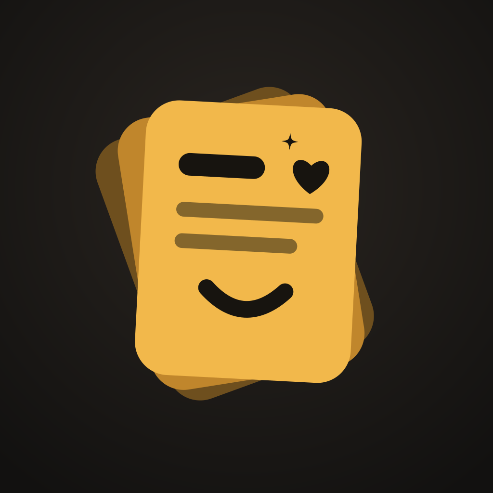
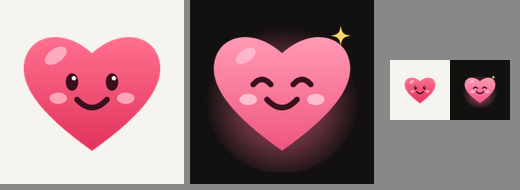

<p align="center">
  
</p>

<h1 align="center">Prompt Heart</h1>

<p align="center"><b>Your AI prompts, one tap away.</b><br/>
A notes-style app for saving, organising and launching the prompts you use with ChatGPT, Claude, Gemini, Grok and more.</p>

<p align="center">
  <a href="../../releases/latest"><b>Download the latest Android APK</b></a> ·
  Android · iOS (build from source) · Web
</p>

---

## Why Prompt Heart

Good prompts get lost in chats, notes apps and screenshots. Prompt Heart keeps them in one place, so you can find one in seconds, fill in the blanks, and paste it into any AI app with one tap.

## Features

**Save and reuse**
- **One-tap copy** from every card. Only the text is copied, never attached images.
- **Templates:** write `{{topic}}` and the app asks for it when you copy, with a live preview. `{{tone|friendly}}` sets a default.
- **Notes-style editor** that autosaves, with a word count and token estimate.
- **Reference images:** attach screenshots or photos to a prompt for context.

**Launch in your AI apps**
- **ChatGPT, Claude, Gemini, Grok, Perplexity, Copilot, DeepSeek and Le Chat.** Switch each one on or off in Settings.
- Each app gets its own category. Prompts saved there get an **Open in Claude** (or another app) button that copies the prompt and opens the app. ChatGPT, Claude, Grok and Perplexity open with it already typed in.
- A quick-launch bar opens any of your apps straight from the home screen.

**Organise**
- **Categories** with colours, **#tags**, **pins**, **search**, and a **Recently copied** filter.
- **List or grid** view. Sort by recently edited, most copied or A–Z.
- **Trash:** deleted prompts stay for 30 days, with Undo and Restore.

**Capture**
- **Save from any app:** share text, links or images to Prompt Heart from Chrome, ChatGPT, Photos and more (Android).
- **Backups:** export everything, images included, to a JSON file, or export a readable Markdown file. Importing merges and never deletes.

**Make it yours**
- **Profile:** your name and photo, and a welcome that changes through the day ("Good morning, Inigo!", "Still up?").
- **Themes:** System, Light or Dark, five accent colours, and a smiling heart that switches between an awake face (light) and a sleepy one (dark).
- **Cloud sync** across devices. It works offline and updates live. You can change your email or password, or delete your account, from the app.

<p align="center">
  
</p>

## Install

1. Open the [latest release](../../releases/latest) on your Android phone and download `promptheart-x.y.z.apk`.
2. Open the file. If Android asks, allow your browser to install apps. If Play Protect warns, choose **Install anyway**.
3. New versions install over the old one and keep your prompts. Smaller updates arrive automatically. To get one straight away, go to **Settings → About → Check for updates**.

## Your data

- **On your device:** prompts and images are stored on the phone and work fully offline.
- **With an account:** your prompts, categories, images, name and photo are stored in a private Supabase project. Row Level Security means each account can only read and write its own data, and images sit in a private bucket under your own folder.
- **Deleting your account** (Profile → Delete account) removes the account and all of its data from the cloud. You choose whether the prompts stay on your phone.

## Tech

[Expo](https://expo.dev) SDK 58 · React Native · Expo Router · TypeScript · [Supabase](https://supabase.com) (Auth, Postgres, Realtime, Storage) · EAS Build and EAS Update.

```
src/
  app/          Screens: home, editor, categories, settings, profile, account, about, trash, share
  components/   Cards, chips, sheets, avatar, brand title, settings building blocks
  lib/          Theme, templates, AI apps, images, backups, greetings
  profile/      Name and photo, synced to the account
  settings/     App settings (theme, accent, layout, AI apps…)
  store/        Prompts and categories, merge rules, seed data
  sync/         Supabase client, sync engine, row mapping
supabase/       Database schema, policies, storage bucket, account deletion
```

## Development

```bash
npm install
npx expo start        # press w for web; scan the QR code for Expo Go
npx tsc --noEmit      # typecheck
npx expo lint         # lint
```

Saving from other apps and image attachments need a real build, because Expo Go and the web version don't include those native parts.

### Cloud sync setup (once)

1. Create a project at [supabase.com](https://supabase.com). The free tier is fine.
2. In **SQL Editor**, run [`supabase/schema.sql`](supabase/schema.sql), which creates the tables, policies, sync trigger and image bucket, then [`supabase/delete_my_account.sql`](supabase/delete_my_account.sql). Both are safe to re-run.
3. Under **Authentication → Sign In / Providers → Email**, turn off **Confirm email** for testing.
4. Copy `.env.example` to `.env.local` and add your project URL and **publishable** key. For cloud builds, set the same two values as EAS environment variables.

How sync works: each change gets a timestamp and is queued. A sync uploads the queue (images first), then downloads anything newer on the server. If two devices edit the same prompt, the most recent edit wins. Deletes are kept as markers so every device hears about them.

### Releasing

```bash
# Code-only changes: published over the air to installed apps
npx eas-cli@latest update --channel preview --environment preview --message "What changed"

# Native changes (new native modules, app name or icon): new build, then a GitHub release
npx eas-cli@latest build --platform android --profile preview
gh release create vX.Y.Z promptheart-X.Y.Z.apk
```

The runtime version uses the `fingerprint` policy, so an over-the-air update only reaches builds whose native code it matches.

## Roadmap

- Play Store release: proper sign-in emails with password reset, a privacy policy and a store listing
- Home-screen widget for pinned prompts
- Bulk select (move, tag or delete many prompts), and version history

## Credits

Made by [Inigo](https://github.com/inigo-code). The title font is [Fredoka](https://fonts.google.com/specimen/Fredoka), and icons are from [Ionicons](https://ionic.io/ionicons).
